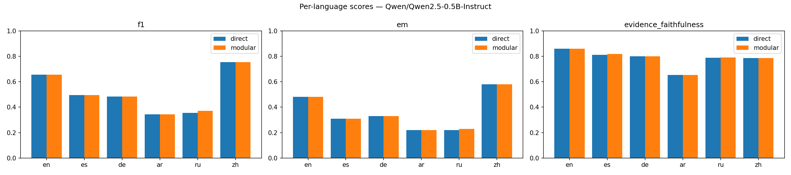
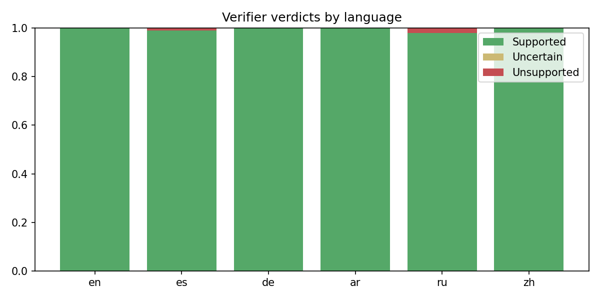
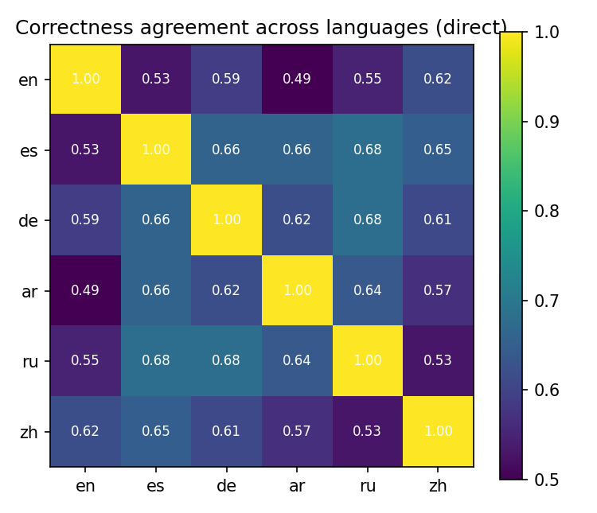
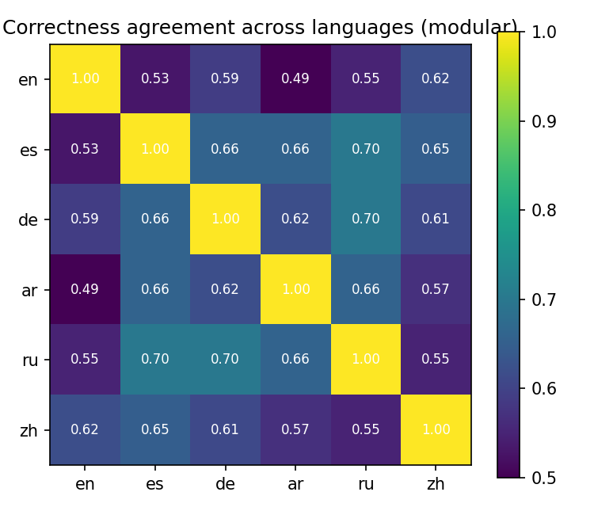

# Multilingual Reliability of Small LLMs on XQuAD: Accuracy Is Not Enough

Most QA benchmarks report a single number: is the final answer right? This project evaluates
a small instruction-tuned LLM along several reliability axes at once, in several languages:

- **Correctness:** Exact Match, token F1 and fuzzy match.
- **Faithfulness:** is the answer a span of the context? Is the cited evidence really in the
  context? Is the explanation grounded in the context, or does it bring in outside facts?
- **Language fairness:** does the model do much better in English than in other languages?
- **Cross-lingual consistency:** XQuAD has the *same* question in every language. Does the
  model get it right (or wrong) consistently across languages?
- **Self-verification:** does a modular *Generator → Verifier → Reviser* pipeline, run by the
  same model, improve on answering directly?

The default model is `Qwen/Qwen2.5-0.5B-Instruct`; any Hugging Face chat model can be used.

## Data

[XQuAD](https://huggingface.co/datasets/google/xquad) is 240 paragraphs and 1,190 question–answer
pairs from the SQuAD v1.1 dev set, professionally translated into 11 languages. Because the
rows are parallel, differences between languages are differences in the *model*, not in the
questions. By default the evaluation samples 100 aligned questions in `en, es, de, ar, ru, zh`.

## Methods

**Direct baseline.** One call: context + question → JSON `{answer, evidence, explanation}`.

**Modular pipeline.**

```
            ┌────────────┐   answer, evidence   ┌────────────┐  Supported   ┌──────────────┐
context ──► │ Generator  │ ───────────────────► │  Verifier  │ ───────────► │ final answer │
question    └────────────┘                      └────────────┘              └──────────────┘
                                                      │ Unsupported / Uncertain   ▲
                                                      ▼                           │
                                                ┌────────────┐  corrected answer  │
                                                │  Reviser   │ ───────────────────┘
                                                └────────────┘
```

The Verifier labels each answer **Supported / Unsupported / Uncertain** with a reason, and the
Reviser sees that feedback. All three roles use the same model, so any gain comes from the
structure of the pipeline rather than extra capacity. The idea of checking a model's output
against itself without external resources comes from SelfCheckGPT.

## Metrics

| Metric | Definition |
|---|---|
| EM / F1 | SQuAD-style, after Unicode-aware normalisation; character-level F1 for `zh`/`th` |
| Fuzzy match | `difflib` similarity ratio to the closest gold answer |
| Answer-in-context | Share of answers that are verbatim spans of the context |
| Evidence faithfulness | 1 if the evidence is a verbatim span of the context, otherwise the coverage of its longest matching block |
| Explanation faithfulness | Share of the explanation's content tokens found in the context, question or answer |
| Language bias | Best/worst language, max–min gap, std across languages, English − non-English mean |
| Cross-lingual consistency | For each parallel question, agreement on correctness (F1 ≥ 0.5) across language pairs; share right in all languages / wrong in all |
| Verifier diagnostics | Verdict distribution, revision rate, F1 before vs after revision, initial F1 when the verifier said Supported vs Unsupported |

## How to run

Everything (code, explanations, results and charts) is in a single notebook: **[`multilingual_llm_eval_xquad.ipynb`](multilingual_llm_eval_xquad.ipynb)**.

1. Open it in Jupyter, VS Code or Google Colab (*Runtime → Change runtime type → GPU*).
2. Run the first cell to install dependencies.
3. Adjust the configuration cell if needed, then *Run all*.

Outputs (tables, JSON, charts) are written to `results/`.

## Results

**Setup:** `Qwen/Qwen2.5-0.5B-Instruct` with greedy decoding, 100 parallel XQuAD questions in each of
6 languages (`en, es, de, ar, ru, zh`) = 600 questions per method. The same model plays generator,
verifier and reviser. All raw outputs are in [`results/results/`](results/results/): `metrics.json`, `summary.md` and
per-question predictions.

### Per-language scores (direct baseline)

| Language | EM | F1 | Fuzzy | Answer in context | Evidence faithf. | Explanation faithf. | Valid JSON |
|---|---:|---:|---:|---:|---:|---:|---:|
| English (en) | 0.48 | 0.655 | 0.731 | 0.90 | 0.859 | 0.667 | 0.98 |
| Spanish (es) | 0.31 | 0.496 | 0.593 | 0.78 | 0.810 | 0.564 | 0.90 |
| German (de) | 0.33 | 0.483 | 0.599 | 0.79 | 0.800 | 0.626 | 0.95 |
| Arabic (ar) | 0.22 | **0.342** | 0.538 | 0.69 | **0.653** | 0.510 | 0.85 |
| Russian (ru) | 0.22 | 0.355 | **0.514** | **0.60** | 0.788 | **0.476** | **0.76** |
| Chinese (zh)* | **0.58** | **0.753** | **0.751** | 0.82 | 0.786 | **0.814** | 0.96 |
| **All** | 0.357 | 0.514 | 0.621 | 0.763 | 0.783 | 0.609 | 0.90 |

\* Chinese F1 is computed at character level, which is more lenient than word-level F1. Its EM is
also the highest, though, so the strong Chinese result is not just a scoring artefact.

### Direct vs. modular (Generator → Verifier → Reviser)

| Method | EM | F1 | Answer in context | Evidence faithf. | Explanation faithf. | Cross-lingual agreement | All 6 correct | All 6 wrong |
|---|---:|---:|---:|---:|---:|---:|---:|---:|
| Direct | 0.357 | 0.514 | 0.763 | 0.783 | 0.609 | 0.605 | 11% | 7% |
| Modular | 0.358 | 0.517 | 0.767 | 0.784 | 0.610 | 0.611 | 12% | 7% |

| Verifier diagnostics (600 questions) | Value |
|---|---:|
| Verdicts: Supported / Unsupported / Uncertain | 99.5% / 0.5% / 0% |
| Answers revised | 3 of 600 |
| Initial F1 when the verifier said *Supported* | 0.517 (same as the overall F1) |
| F1 of the 3 revised answers: before → after | 0.00 → 0.56 |





<p float="left">
  
  
</p>

## Analysis

**1. Accuracy alone hides most of the picture.** Overall F1 is 0.51, but only 76% of answers are
verbatim spans of the context, even though the prompt requires extractive answers. On average, only ~61% of the
content words in an explanation appear in the context, question or answer; the rest is wording the
model brought in itself. F1 alone shows neither problem.

**2. There is a large language gap, and English is not on top.** F1 ranges from 0.34 (Arabic) to
0.75 (Chinese), a gap of **0.41**. English (0.655) beats the four other non-Chinese languages by
**0.24 F1** on average (vs. 0.42 for es/de/ar/ru), but Chinese beats English. This is consistent
with Qwen's heavily English- and Chinese-weighted training data, and it is a reminder that "language
bias" is about each model's training mix, not just "English vs. the rest". Arabic and Russian, the
two non-Latin, non-Chinese scripts, are the weakest on almost every metric.

**3. The model is not consistent across languages.** The same question, translated, gets a
consistent outcome only **60.5%** of the time on average across language pairs. Only **11%** of
questions are answered correctly in all six languages (7% are wrong in all six). The lowest pairwise
agreement is English–Arabic (0.49), roughly a coin flip. For a 0.5B model, whether a question gets
answered correctly depends heavily on the language it is asked in.

**4. Instruction following degrades outside English, and it compounds the gap.** Valid-JSON output
drops from 98% (en) to 76% (ru), and Russian answers are ~40% longer than the gold spans (33 vs. 23
characters) and the least often copied from the context (60%). The model tends to paraphrase
instead of extracting. Parsing failures are **not** the main cause of the gap, though: the tolerant
fallback parser recovers most answers, and scoring only correctly parsed outputs moves Russian F1
from 0.355 to just 0.397.

**5. Self-verification with the same 0.5B model does almost nothing.** The verifier labelled
**99.5%** of answers *Supported*, so it is effectively a rubber stamp. Its *Supported* answers have
exactly the same average F1 as all answers (0.517), meaning it does not tell right from wrong. All 3
revisions it triggered were cases where the generator had produced broken JSON (the "answer" was the
literal text "```json"): 2 were fixed, 1 replaced with a different wrong answer. The pipeline
therefore costs **~2× the inference** for **+0.003 F1**. This matches the concern in the assignment:
when one model is both generator and verifier, the verifier shares the generator's blind spots
(correlated errors). A 0.5B model also lacks the reasoning needed to check faithfulness, and is
biased toward agreeing with an answer it is shown.

**6. Language bias as a fairness issue.** Speakers of Arabic and Russian would get answers that are
roughly half as accurate, less often grounded in the source, and less often correctly formatted
than English or Chinese speakers using the same system. If deployed, this is an equity problem (the
"language-based bias" dimension of DecodingTrust), not just a benchmark artefact.

### Limitations

- One small model (0.5B), 100 questions per language, single run with greedy decoding.
- Evidence and explanation faithfulness are lexical heuristics (span matching and token overlap),
  not semantic judgements, so paraphrased but correct explanations are penalised.
- Character-level F1 for Chinese is not directly comparable to word-level F1 for other languages.
- Prompts are in English for every language, which may itself disadvantage some languages.

### Next steps

- Use a **stronger or separate verifier** (e.g. Qwen2.5-1.5B/3B) to test whether verification helps
  once the errors are no longer correlated.
- Use a stricter verifier prompt, or have it quote the supporting span instead of giving a free-form
  verdict, to counter the "always Supported" behaviour.
- Use native-language prompts, more languages (hi, th, tr), and larger samples with multiple seeds.

## References

- Liang et al., *Holistic Evaluation of Language Models (HELM)*, 2022. [arXiv:2211.09110](https://arxiv.org/abs/2211.09110)
- Wang et al., *DecodingTrust: A Comprehensive Assessment of Trustworthiness in GPT Models*, 2023. [arXiv:2306.11698](https://arxiv.org/abs/2306.11698)
- Manakul et al., *SelfCheckGPT: Zero-Resource Black-Box Hallucination Detection for Generative LLMs*, 2023. [arXiv:2303.08896](https://arxiv.org/abs/2303.08896)
- Artetxe et al., *On the Cross-lingual Transferability of Monolingual Representations* (XQuAD), 2020. [arXiv:1910.11856](https://arxiv.org/abs/1910.11856)

---
*Developed as part of the Large Language Models course, University of Tehran (Spring 2026).*
